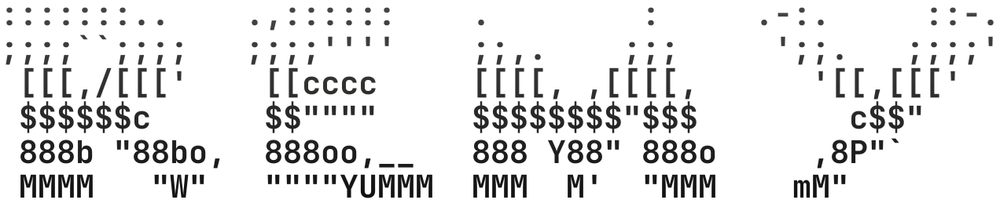

<picture>
  <source media="(prefers-color-scheme: dark)" srcset="branding/logo/remy-wordmark-on-dark.svg">
  
</picture>

**Your assistant, anywhere.**

Remy is an open-source AI agent that completes digital tasks through plain conversation. You say what you need, it does the work, and it asks before anything that sends as you, spends money, or can't be undone.

> Status: early. Remy runs in the terminal and does research, web reading and file work, and connects to apps such as GitHub, Notion and Linear through MCP servers. Long tasks, a local browser and scheduled work are next on the [roadmap](PLAN.md#capability-track-0509-in-the-terminal-decided-2026-10-28).

## What makes it different

- **Any model.** Use OpenAI, Anthropic, Google Gemini, OpenRouter, Groq, DeepSeek, Mistral, xAI, Ollama and more, or any OpenAI-compatible endpoint, including free open-weight models. Weaker models get a constrained JSON mode.
- **Safety enforced in code, not prompts.** Every tool call goes through a policy engine. After Remy reads anything untrusted (a web page, an email), every action beyond reading needs your approval. An approval covers the exact action you saw, once.
- **Survives crashes without repeating itself.** Every step is an event in a log. Kill the process at any point and `remy resume` picks up where it left off. An action that might already have happened is never re-run without asking.
- **Measured.** An eval suite tracks success, reliability, cost, latency, safety violations and duplicate actions. Changes that regress it are blocked.

## Quick start

You need Node 22.18 or newer.

```sh
npm install -g @koryei/remy
remy login
remy
```

### Models

`remy login` stores your key in the macOS Keychain, or in a private file in `~/.remy` (mode 0600) elsewhere. `remy login --list` shows what is saved (never the keys), `remy logout <provider>` forgets one, and `echo $KEY | remy login openai --key-stdin` works without a terminal.

| Provider      | Profile            | Key variable         | Notes                                                        |
| ------------- | ------------------ | -------------------- | ------------------------------------------------------------ |
| OpenAI        | `openai`           | `OPENAI_API_KEY`     | OpenAI-compatible API                                        |
| OpenRouter    | `openrouter`       | `OPENROUTER_API_KEY` | Many models, some free                                       |
| Groq          | `groq`             | `GROQ_API_KEY`       | OpenAI-compatible API                                        |
| Anthropic     | `anthropic`        | `ANTHROPIC_API_KEY`  | Native Messages API                                          |
| Google Gemini | `google`           | `GEMINI_API_KEY`     | Native Gemini API                                            |
| DeepSeek      | `deepseek`         | `DEEPSEEK_API_KEY`   | OpenAI-compatible API                                        |
| Mistral       | `mistral`          | `MISTRAL_API_KEY`    | OpenAI-compatible API                                        |
| xAI Grok      | `xai`              | `XAI_API_KEY`        | OpenAI-compatible API                                        |
| Together AI   | `together`         | `TOGETHER_API_KEY`   | OpenAI-compatible API                                        |
| Fireworks AI  | `fireworks`        | `FIREWORKS_API_KEY`  | OpenAI-compatible API                                        |
| Cerebras      | `cerebras`         | `CEREBRAS_API_KEY`   | OpenAI-compatible API                                        |
| Nebius        | `nebius`           | `NEBIUS_API_KEY`     | OpenAI-compatible API                                        |
| Moonshot Kimi | `moonshot`         | `MOONSHOT_API_KEY`   | OpenAI-compatible API                                        |
| Z.ai GLM      | `zai`              | `ZHIPU_API_KEY`      | OpenAI-compatible API                                        |
| DeepInfra     | `deepinfra`        | `DEEPINFRA_API_KEY`  | OpenAI-compatible API                                        |
| Alibaba Qwen  | `alibaba`          | `DASHSCOPE_API_KEY`  | OpenAI-compatible API                                        |
| Inception     | `inception`        | `INCEPTION_API_KEY`  | Mercury models, free tokens on a new key                     |
| Zro           | `zro`              | `ZRO_API_KEY`        | DeepSeek and GLM Flash models, free daily use                |
| 0G            | `zerog`            | `ZEROG_API_KEY`      | One key for Claude, GPT, GLM and more, at the router's rates |
| Ollama        | `ollama`           | none                 | Local models                                                 |
| Anything else | `--base-url <url>` | `REMY_API_KEY`       | Any OpenAI-compatible endpoint (or `custom` in `remy login`) |

Settings are resolved per field: flags, then environment variables, then a saved login, then `remy.config.json`. Without a login, set `REMY_PROFILE`, `REMY_MODEL` and the key variable instead, for example `REMY_PROFILE=anthropic REMY_MODEL=claude-sonnet-5-5 ANTHROPIC_API_KEY=...`. Prices and context windows for common models (Claude Opus, Sonnet and Haiku, Gemini 2.5 Pro, Flash and Flash-Lite, GPT-5 nano, the default model of each provider above) are built in; other ids work and are shown with unknown cost, or you can list them in a `models.json`.

Plain `remy` in a terminal opens the chat full screen, on a calm home screen with the input box centered: type a message, and each one carries the earlier ones as context. Replies stream in, tool calls show as they run, and Remy asks for a `y` or `n` before anything that needs approval. PgUp and PgDn scroll the conversation, Ctrl+B shows the sidebar on wide terminals, and Ctrl+R searches what you sent before. Ctrl+C stops a running task (resume it with `remy resume <id>`), Ctrl+D quits. Type `/` for commands as you type (`/model` switches the model, `/login` connects a provider, `/sessions` picks up an unfinished task), press Ctrl+P for the command palette, and type `@` to attach a file from the workspace. With nothing connected yet, `remy` opens on the login panel. `/help` lists the rest. `/theme auto|light|dark` (or `/day`, `/night`) switches the colors at once and remembers the choice. `remy --minimal` opens a quieter scrolling chat with no header art, and `/minimal` makes it the default. Use `--reduced-motion` to turn off animation and `NO_COLOR=1` to turn off color. For scripts, run one task directly:

```sh
remy run "Summarize https://example.com in three bullet points"
```

### Connections

Remy reaches your apps through [MCP](https://modelcontextprotocol.io) servers. `remy connect` (or `/connect` in the chat) offers a short list: GitHub, Notion, Linear, Sentry, a folder of files, memory and web pages. Pick one and Remy asks only for what it needs: a sign-in in your browser, a token, or a folder. `remy connect add <name> -- <command>` or `--url <url>` adds any other server, and `remy connect --import` brings in the servers Claude Desktop or Claude Code already use, after showing you the list. Tokens go in the Keychain; a server that runs on your machine is shown with its exact command before it is added. `/connections` shows each server, its status and tool count, and turns servers off and on.

Tools from a connection ask before they act unless the server marks them read-only and is on the list above. What a connection returns is treated as untrusted, like a web page. On an approval card, `a` always allows that tool from then on (writes and sends only, never deletes or payments); `/approvals` or `remy approvals` lists and removes those.

### Trust levels

By default Remy asks before it changes anything. `/trust` (or `remy trust <level>`) lets it go ahead with more:

- `ask` (default): every change waits for you.
- `steady`: low-risk, reversible work goes ahead without a card: writing, editing, moving files and making folders in the task's workspace (a file it replaces is kept beside the new one as `<name>.before-remy`), saving a note, and adding a schedule.
- `away`: as steady, plus saving a skill. It is meant for long runs while you are not at the keyboard. When something still needs a card, the task carries on with the rest of the work while the card waits.

At every level Remy still asks before spending money, sending or posting as you, deleting, running commands, and anything after it has read a web page, search result, email or pasted text. A tool you blocked stays blocked, a connected app follows `/approvals` only, and helpers never get the level. The level shows in the status row. A task keeps the level it started with, including after a restart; a change applies to new tasks.

At `away`, a card does not stop the task. The action waits, unrun, and the model is told which actions wait and to carry on with whatever does not depend on them. Up to three cards wait at once; a fourth stops the task, as at every other level. A waiting action runs only if you approve those exact arguments, once. If you decline, it is recorded as declined and the model is told. The task never finishes as done while a card waits: when the model tries to finish, the task pauses with what is done and what waits, and carries on once you have answered the last card. A card from a task that read untrusted content, and every helper's card, is still a card you answer. A restart with cards waiting brings back the same cards and runs nothing twice.

For a job that should run for hours, `remy run --background --for 3h "<task>"` sets the clock, the steps and the cost together and prints the most it can spend before it starts. It pauses when any of them runs out, and `remy continue <id>` adds more. A crash or restart picks the task up where its record ends.

### Skills

Skills are short how-tos Remy follows for kinds of tasks. Five are built in, and `remy skills add <link>` takes your own or one from GitHub. It shows you the whole text first. Skills from a link stay limited: reading one means any action needs your approval.

To look for more, `remy skills find <query>` searches skills.sh, and `remy skills find <query> --bots` searches botdirectory.ai (the Skills screen in the web app has the same search). Add one with `remy skills add skills.sh:<owner/repo/skill>` or `remy skills add bot:<slug>`. A skills.sh skill is fetched from its GitHub repository and pinned to the commit; a bot becomes a skill whose text starts with its source and a note that it was written by someone else. Both are text only, shown to you before anything is saved, and a name you already have is never replaced. Anyone can publish to these directories and nothing is checked for you, so only you can install: no tool Remy has reaches the install, and a page or an email cannot add a skill.

When you correct Remy ("no, use the other folder", "next time check the date first"), it may offer once, before it finishes, to save the fix as a short how-to: a title, when it applies and one to five steps, in your words. You see the whole text on an approval card and nothing is saved until you approve. The next similar task gets those steps with your message. How-tos you saved this way show as `[learned]` in `/skills` and `remy skills list`; edit the file that `remy skills show <name>` prints, or remove one with `remy skills rm <name>`. Remy never saves a secret in one, offers nothing when personalising is off, and helpers and scheduled runs never offer.

### Schedules

Ask for something to happen regularly, or run `remy schedule add "every day at 9" "Summarize the news"`. `remy daemon install` keeps schedules running: a LaunchAgent on macOS, a systemd user unit on Linux, a Scheduled Task on Windows. Each run asks before it acts, so nothing changes while you are away without your approval. `remy doctor` shows what is set up.

#### The daemon on Linux and Windows

These two were generated and unit-tested, but not yet installed on a real Linux or Windows machine. Treat them as untried until you have run them once.

- **Linux.** `remy daemon install` writes `~/.config/systemd/user/remy.service` (`Restart=on-failure`, the full path to the node that ran it, `WantedBy=default.target`), then runs `systemctl --user daemon-reload` and `systemctl --user enable --now remy.service`. `uninstall` disables and removes it, and `status` reads `systemctl --user is-active`. Where systemd user services are not available (no `systemctl`, a container, WSL without systemd), Remy says so in one line and prints the plain command to run in your own service: `remy daemon run`. A user service stops when you log out. To keep it running, you can run `loginctl enable-linger` yourself; Remy never runs it.
- **Windows.** `remy daemon install` creates a Scheduled Task named `RemyDaemon` that runs at logon in your own session, with limited rights and never as administrator: `schtasks /Create /SC ONLOGON /TN RemyDaemon /TR "<node> <script> daemon run" /RL LIMITED /F`. `uninstall` runs `schtasks /Delete` and `status` runs `schtasks /Query`. Windows allows 261 characters for the task command, so a very long install path is refused with a message.

`remy doctor` shows which of the three applies and the one step to turn it on.

### Search

Remy picks its search route on its own, in this order: a search service with a key (Exa, TinyFish, Perplexity, Tavily, Linkup, Serper, Brave, Context.dev, then your own SearXNG address), then a container (`remy browser vm start`, needs Docker or Colima and about 2 GB), then a hidden browser on your machine with no key. Nothing opens on your screen. Search engines often turn the hidden browser away, so a service key is the steadiest start (TinyFish has a free one).

**Search.** Pick your own service by giving Remy its key. A key is read from the environment first (`EXA_API_KEY`, `TINYFISH_API_KEY`, `PERPLEXITY_API_KEY`, `TAVILY_API_KEY`, `LINKUP_API_KEY`, `SERPER_API_KEY`, `BRAVE_API_KEY`, `CONTEXT_DEV_API_KEY`, `SEARXNG_URL`), then, on a Mac, from the Keychain (service `remy`, account `exa`, `tinyfish`, `perplexity`, `tavily`, `linkup`, `serper`, `brave` or `context`; `REMY_KEYCHAIN=off` skips it). `remy search key <service>` saves one there without showing it (hidden prompt, or pipe it with `--key-stdin`). `remy search` shows which route answers and why, and where each key was found. `remy search test [<service>]` runs one real search and prints the top three results and the time; it uses one request of your own credit. `REMY_SEARCH=<service>` (or `"search"` in `remy.config.json`) forces one route and ignores the rest. If a route stops working (a refused key, no credit, Docker gone, a bot check), Remy skips it for the rest of the session, uses the next one and says which answered. It never solves a bot check. Whatever a search returns is untrusted text: it can inform an answer but never gives Remy instructions, and a task that read it needs approval for anything beyond reading. With no route, Remy tells you the one step to take. `remy doctor` shows the route, the order and the step.

### Helpers

`REMY_HELPERS=on` lets Remy hand separate parts of a task to up to 3 read-only helpers working at once.

Roles are optional. Write them in `~/.remy/helpers.md`, or in `.remy/helpers.md` in a project (the project wins by name):

```
## scout
Tools: web_search, fetch_url
Look the thing up and give each claim with its link.
```

A role adds instructions and narrows the helper's tools; it never widens them. `researcher` and `checker` are built in. Roles from a project folder start the helper tainted, so any change it asks for needs your approval. `remy doctor` lists mistakes in the files.

`REMY_HELPERS=act` also lets a helper whose role has an `Act: yes` line ask to change things. Each change shows up as an approval card marked with the helper's name, and nothing runs until you approve those exact arguments. Only one acting helper runs per call.

Useful commands: `remy list`, `remy show <id>` (the full timeline), `remy resume <id>`, `remy approve <id> [--deny]`, `remy cancel <id>`. Add `--debug` to any command to log model requests, responses and events as JSON lines (to stderr, or to `~/.remy/debug-<time>.jsonl` in the chat). Remy searches and browses in its own hidden browser on your computer, no key needed; `remy browser show` opens it so you can sign in to sites. `REMY_SEARCH` forces one search route (`exa`, `tinyfish`, `perplexity`, `tavily`, `linkup`, `serper`, `brave`, `context`, `searxng`, `vm`, `browser` or `off`).

## From source

```sh
git clone https://github.com/remy-plus/remy.git && cd remy
corepack enable && pnpm install
pnpm remy login
pnpm remy
```

See [CAPABILITIES.md](CAPABILITIES.md) for what Remy can and cannot do yet.

## Development

```sh
pnpm check         # lint, typecheck, build, tests
pnpm eval:replay   # deterministic eval run (the CI gate)
pnpm eval --profile openrouter --model <id> --k 3   # live eval
```

The architecture, the reasoning behind it and the roadmap are in [PLAN.md](PLAN.md). [CONTRIBUTING.md](CONTRIBUTING.md) explains how to send a change, and [docs/evals.md](docs/evals.md) has the numbers, and [docs/webhooks.md](docs/webhooks.md) covers starting a task from another program. Packages:

| Package            | What it does                                                                     |
| ------------------ | -------------------------------------------------------------------------------- |
| `packages/core`    | Events, reducer, `nextAction`, runner, policy engine. Depends only on interfaces |
| `packages/store`   | Event store: in-memory and SQLite                                                |
| `packages/models`  | OpenAI-compatible client, native and JSON tool-calling strategies, record/replay |
| `packages/tools`   | Built-in tools behind a jailed filesystem and an SSRF-guarded network            |
| `packages/browser` | Remy's own browser, its tools and search                                         |
| `packages/mcp`     | Connections to apps through MCP servers                                          |
| `packages/evals`   | Eval cases, mock world, graders, metrics, regression compare                     |
| `apps/cli`         | The `remy` command                                                               |

## License

[Apache-2.0](LICENSE). The Remy name and logo are not covered by the license; see [branding/README.md](branding/README.md).
