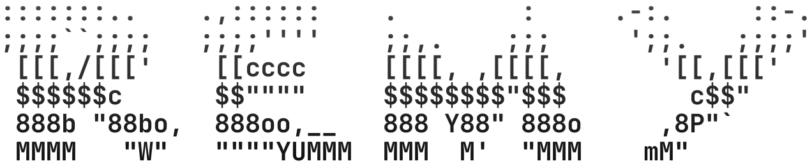

<picture>
  <source media="(prefers-color-scheme: dark)" srcset="branding/logo/remy-wordmark-on-dark.svg">
  
</picture>

**Real work, quietly done.**

Remy is an open-source AI agent that completes digital tasks through plain conversation. You say what you need, it does the work, and it asks before anything that sends as you, spends money, or can't be undone.

> Status: Phase 0, an early prototype. Remy runs from the command line and does research, web reading and file work. The web app, integrations and browser automation are on the [roadmap](PLAN.md#product-roadmap-after-phase-0).

## What makes it different

- **Any model.** Use OpenRouter, Ollama, or any OpenAI-compatible endpoint, including free open-weight models. Weaker models get a constrained JSON mode.
- **Safety enforced in code, not prompts.** Every tool call goes through a policy engine. After Remy reads anything untrusted (a web page, an email), every action beyond reading needs your approval. An approval covers the exact action you saw, once.
- **Survives crashes without repeating itself.** Every step is an event in a log. Kill the process at any point and `remy resume` picks up where it left off. An action that might already have happened is never re-run without asking.
- **Measured.** An eval suite tracks success, reliability, cost, latency, safety violations and duplicate actions. Changes that regress it are blocked.

## Quick start

Requires Node 22.18+ and pnpm (via `corepack enable`).

```sh
git clone https://github.com/remy-plus/remy.git && cd remy
pnpm install

# Pick a model. Free models on OpenRouter work:
export REMY_PROFILE=openrouter OPENROUTER_API_KEY=sk-or-...
export REMY_MODEL=google/gemma-4-26b-a4b-it:free
# Or a local model:  export REMY_PROFILE=ollama REMY_MODEL=qwen2.5:7b

pnpm remy
```

Plain `remy` in a terminal opens the chat: type a message, and each one carries the earlier ones as context. Replies stream in, tool calls show as they run, and Remy asks for a `y` or `n` before anything that needs approval. Ctrl+C stops a running task (resume it with `remy resume <id>`), Ctrl+D quits, `/help` lists the rest. Use `--reduced-motion` to turn off animation and `NO_COLOR=1` to turn off color. For scripts, run one task directly:

```sh
pnpm remy run "Summarize https://example.com in three bullet points"
```

Useful commands: `remy list`, `remy show <id>` (the full timeline), `remy resume <id>`, `remy approve <id> [--deny]`, `remy cancel <id>`. Add `--debug` to any command to log model requests, responses and events as JSON lines (to stderr, or to `~/.remy/debug-<time>.jsonl` in the chat). Web search is enabled when `BRAVE_API_KEY`, `TAVILY_API_KEY` or `SEARXNG_URL` is set.

## Development

```sh
pnpm check         # lint, typecheck, build, tests
pnpm eval:replay   # deterministic eval run (the CI gate)
pnpm eval --profile openrouter --model <id> --k 3   # live eval
```

The architecture, the reasoning behind it and the roadmap are in [PLAN.md](PLAN.md). Packages:

| Package           | What it does                                                                     |
| ----------------- | -------------------------------------------------------------------------------- |
| `packages/core`   | Events, reducer, `nextAction`, runner, policy engine. Depends only on interfaces |
| `packages/store`  | Event store: in-memory and SQLite                                                |
| `packages/models` | OpenAI-compatible client, native and JSON tool-calling strategies, record/replay |
| `packages/tools`  | Built-in tools behind a jailed filesystem and an SSRF-guarded network            |
| `packages/evals`  | Eval cases, mock world, graders, metrics, regression compare                     |
| `apps/cli`        | The `remy` command                                                               |

## License

[Apache-2.0](LICENSE). The Remy name and logo are not covered by the license; see [branding/README.md](branding/README.md).
